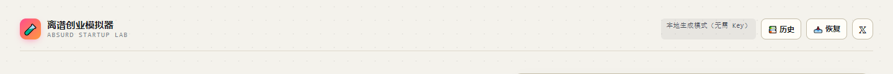
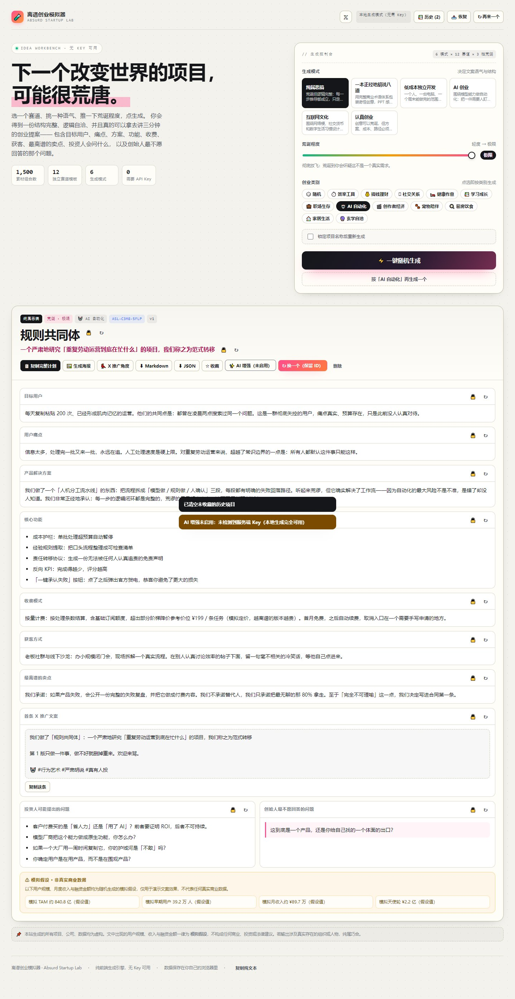
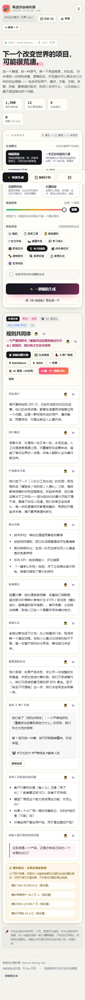
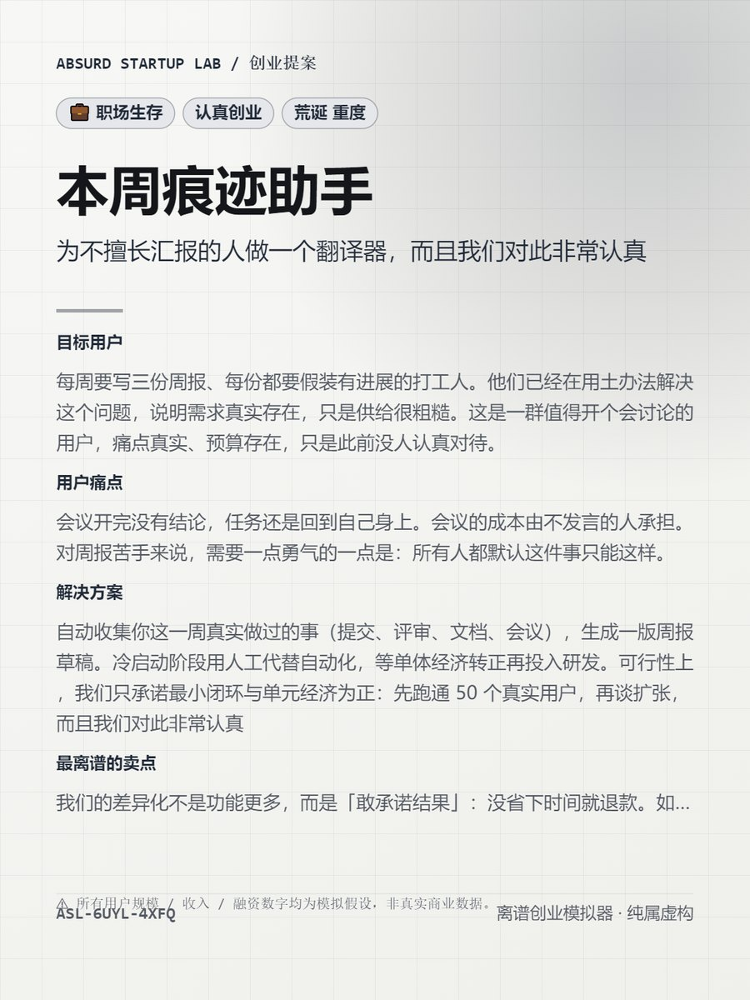
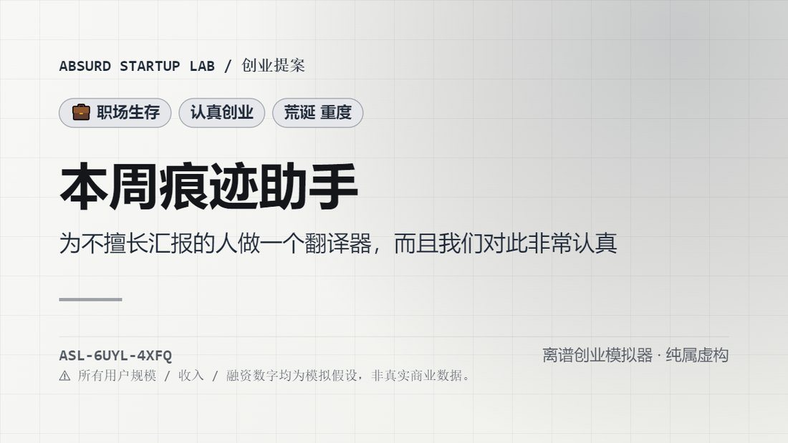
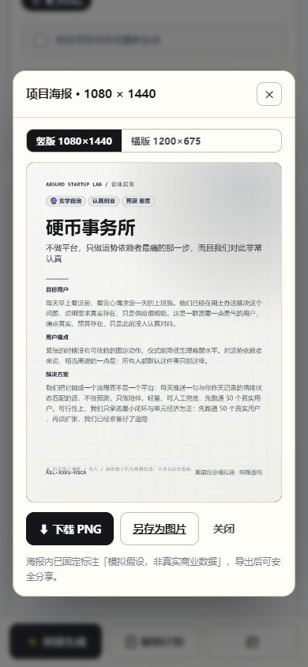
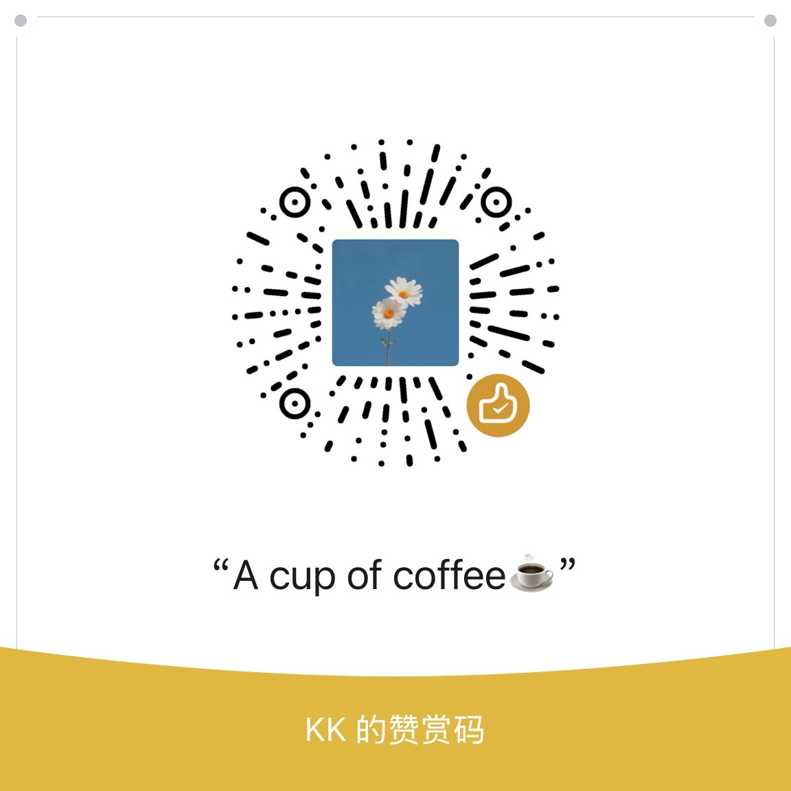

<div align="center">



# 离谱创业模拟器 · Absurd Startup Lab

**下一个改变世界的项目，可能很荒唐。**

选一个赛道、挑一种语气、推一下荒诞程度，点生成 ——
你就能得到一份结构完整、逻辑自洽、**真的可以拿去讲三分钟**的虚构创业提案。

<br />

[](https://absurd-startup-lab.pages.dev/)
[](https://iiiiiiiiiiiiiKK.github.io/absurd-startup-lab/)
[](./TEST-REPORT.md)
[](#-可选-ai-增强)
[](./LICENSE)

[](https://react.dev/)
[](https://www.typescriptlang.org/)
[](https://vitejs.dev/)
[](#)
[](#)

[**在线体验**](https://absurd-startup-lab.pages.dev/) · [**功能全览**](#-功能全览) · [**生成逻辑**](#-生成逻辑重点) · [**部署**](#-部署) · [**测试报告**](./TEST-REPORT.md)

</div>

---

## 🧪 这是什么

一个「独立创业实验室」风格的 Web 工具。

市面上有无数 AI 项目生成器，但它们都要 Key、要联网、要等。
**这个不要。** 打开就能用，断网也能用，生成速度是毫秒级。

它做的是这件事情：

> 把「创业提案」这个严肃格式，套在一个刻意荒谬的创意上，
> 然后用**完整、自洽、不敷衍**的商业逻辑把它支撑起来。
>
> 不是随机词拼接。每一句话都经过语义兼容校验 ——
> 你的目标用户真的会遇上这个痛点，这个方案真的对着这个痛点。

看看它能生成什么：

<table>
<tr>
<td width="50%">

**「明天再做」**
> 专门帮助拖延症患者规划明天要做的事情，并将所有未完成事项自动延期。

`效率工具` · `纯属恶搞` · `重度`

</td>
<td width="50%">

**「冷静期」**
> 不记账，也能知道钱去哪了。把冲动消费的那 3 秒，拉长到 3 分钟。

`搞钱理财` · `低成本独立开发` · `轻度`

</td>
</tr>
<tr>
<td width="50%">

**「例外引擎」**
> 把最无聊的 80% 拿走，人只做判断。

`AI 自动化` · `AI 创业` · `认真创业`

</td>
<td width="50%">

**「九十秒仪式」**
> 不预测未来，只帮你说出你想选的那个。

`玄学自洽` · `一本正经地胡说八道` · `极限`

</td>
</tr>
</table>

---

## ✨ 亮点

| | |
|---|---|
| 🎲 **7,200+ 有效组合** | 12 个独立赛道 × 6 种生成模式 × 3 档荒诞程度，每种组合都有独立模板 |
| 🔒 **字段级控制** | 锁住喜欢的项目名，重生成其它部分；12 个字段都能单独 `↻` 重生成 |
| 🧠 **语义兼容引擎** | 用标签交集强约束「人群→痛点→机制」链路，杜绝无意义拼接 |
| 🆔 **固定 ID** | `ASL-7F3K-92QX` 写进 URL hash，可直接分享恢复；也能导入 JSON 还原 |
| 🖼️ **真实可下载海报** | Canvas 直绘 1080×1440 / 1200×675，带排版自审，超长内容不溢出 |
| 🐦 **5 条 X 推广角度** | 官宣 / 痛点 / 自嘲 / 公开构建 / 求反馈，每条自动控在 280 字符内 |
| 📤 **四种导出** | 一键复制、Markdown、JSON、PNG 海报 |
| 🔐 **零 Key 依赖** | 默认纯前端引擎；AI 增强是**可选**的，且 Key 只存在于服务端 |
| ⚠️ **合规兜底** | 任何收入 / 用户规模 / 融资金额都强制标注为「模拟假设」 |
| 📱 **移动端可用** | 底部固定「快速生成 / 复制 / 历史」操作条，320px 宽也不溢出 |

---

## 🚀 一分钟上手

```bash
# 需要 Node ≥ 18
git clone https://github.com/iiiiiiiiiiiiiKK/absurd-startup-lab.git
cd absurd-startup-lab
npm install

npm run dev        # http://127.0.0.1:5180
```

生产构建：

```bash
npm run build      # 产物在 dist/
npm run preview    # http://127.0.0.1:4285
```

不想装 Node？把 `dist/` 丢给任意静态服务器：

```bash
npx serve dist
# 或
python -m http.server 8080 --directory dist
```

---

## 📸 界面预览

<div align="center">

### 桌面端 · 创意工作台



<br /><br />

### 移动端 · iPhone



<sub>底部吸附操作条让「快速生成 + 一键复制」永远只需要一次点击</sub>

</div>

---

## 🖼️ 生成的海报

海报是 Canvas 直绘的位图，**不是截图**，所以分辨率永远是干净的：

<div align="center">





<sub>竖版 1080×1440（适配小红书 / 朋友圈） · 横版 1200×675（适配 X / OG 卡）</sub>

</div>

每张海报底部固定印着项目 ID 和「模拟假设，非真实商业数据」的声明 ——
**分享出去也不会误导任何人**。

---

## 🎛️ 功能全览

### 生成模式（6 种）

每种模式都有**独立的**语气、句式、功能池、卖点池、问题池和配色。
切换模式时，整个提案的「人格」都会变 —— 不只是换几个词。

| 模式 | 一句话 | 你会看到 |
|---|---|---|
| 🎪 **纯属恶搞** | 荒诞但逻辑完整 | 「每一步的逻辑闭环都是完整的，荒谬的只是起点本身」 |
| 💼 **一本正经地胡说八道** | 商业术语包装奇怪创意 | 能力中台、价值链路、范式迁移、ROI 归因沙盘 |
| 🛠️ **低成本独立开发** | 一个人 + 一个周末 | 「整个产品 3 个界面，代码不到 4000 行」 |
| 🤖 **AI 创业** | 围绕模型能力做自动化 | Agent 流水线、人工兜底队列、成本护栏 |
| 🌐 **互联网文化** | 网络梗、社交货币 | 「产品设计的核心是可截图度」 |
| 📋 **认真创业** | 创意可以荒诞，方案必须可行 | 单体经济、最小闭环、先跑通 50 个真实用户 |

### 荒诞程度（3 档滑块）

不只是形容词变夸张，它真的影响：

- 定价倍数（×1 / ×3.2 / ×11）
- 指标规模倍数（×1 / ×8 / ×40）
- 句尾强化短语
- 标签

### 12 个独立赛道

每个赛道都有自己的 5 类人群、5 类痛点、5 类机制、6 个功能、3 种定价、4 个渠道、4 个卖点、3 个投资人问题、2 个「最不愿回答的问题」。

```
⏱️ 效率工具   💰 搞钱理财   🫂 社交关系   🛌 健康作息
📚 学习成长   💼 职场生存   🤖 AI 自动化   🎬 创作者经济
🐾 宠物陪伴   🍳 厨房饮食   🏠 家居生活   🔮 玄学自洽
```

### 交互功能

<table>
<tr>
<td width="50%" valign="top">

**生成与控制**
- ⚡ 一键随机生成
- 🎯 按类别生成（点赛道标签即生成）
- 🔒 锁定项目名称后重生成其它字段
- ↻ 12 个字段各自独立重生成
- 🔁 「换一个」保留固定 ID，只递增版本号

</td>
<td width="50%" valign="top">

**保存与分享**
- ☆ 收藏 / 🗑️ 删除 / 📚 历史面板
- 📋 一键复制完整计划（Markdown）
- ⬇️ 导出 Markdown / JSON
- 🖼️ 生成并下载海报（两种尺寸）
- 🐦 5 条 X 推广角度，逐条复制
- 📥 导入 JSON 恢复项目

</td>
</tr>
</table>

### 界面细节

- **荒诞模式**：每种模式一个主色（粉 / 蓝 / 绿 / 紫 / 橙），趣味标签，网格背景
- **严肃模式**：自动切成克制的文档风 —— 去掉渐变、降低饱和度、加强留白
- **移动端**：底部吸附操作条、弹窗不溢出、历史抽屉全宽、安全区适配

<div align="center">



</div>

---

## 🧠 生成逻辑（重点）

这是这个项目和「随机词生成器」最本质的区别。

### 1. 素材库结构

每个赛道独立维护 11 类素材，全部带**语义标签**：

```ts
CategoryData {
  audiences[5]          // 目标人群  (label / short / trait / tags)
  pains[5]              // 痛点      (label / detail / tags)
  mechanics[5]          // 产品机制  (label / action / why / tags)
  features[6]           // 候选功能
  pricing[3]            // 定价模型
  channels[4]           // 获客渠道 + 具体打法
  wilds[4]              // 赛道级卖点
  investorQuestions[3]  // 投资人问题
  dreadQuestions[2]     // 最不愿回答的问题
  taglines[4]           // 赛道级口号
  names{prefixes, cores, suffixes}
}
```

### 2. 语义兼容规则

随机拼接最容易出的问题是「这个办法不解决这个问题」。
所以生成器按三级链路强约束（最多 80 次重试）：

```
audience.tags ∩ pain.tags     ≠ ∅   →  这个人确实会遇到这个问题
pain.tags     ∩ mechanic.tags ≠ ∅   →  这个办法确实对着这个痛点
features 优先取与 pain.tags 相关的  →  功能不跑题
```

举个真实例子：

```
拖延症患者  [time, focus, anxiety, routine]
    ↓ 交集
待办清单越列越长  [time, routine, anxiety, focus]
    ↓ 交集
自动延期引擎  [time, routine, anxiety]
```

这条链路 100% 成立（单元测试对 12 赛道 × 40 次抽样 = 480 组全量校验）。

### 3. 短期去重

- 每次生成算一个签名：`category|mode|audience|pain|mechanic|name`
- 写进最近 40 条签名环形缓冲
- 命中就换派生 seed 重试（最多 40 次）
- 仍冲突才回落，并提示「已避开近期重复」

实测：连续 60 次生成，0 重复签名。

### 4. 固定 ID 与确定性

- ID 格式 `ASL-XXXX-XXXX`，字符集剔除易混淆的 `O/0/I/1`
- 同一 ID 重生成 → 保留 ID，只递增 `revision`
- 当前 ID 同步进 URL hash（`#ASL-7F3K-92QX`），分享链接即可恢复
- 生成是**确定性**的：同 seed + 同配置 → 字节级相同的内容

### 5. 数据流

```
控制台 (mode / spice / category / locks)
        │
        ▼
  generate.ts  ──► 语义过滤 ──► 模板填充 ──► 去重校验
        │
        ▼
   Project (12 字段 + metrics + id)
        │
        ├──► localStorage（120ms 防抖 + 严格校验）
        ├──► Markdown / JSON 导出
        ├──► Canvas 海报（含排版自审）
        └──► X 推广角度（5 个，280 字符内）
```

---

## 🔐 可选 AI 增强

**首版完全不依赖 AI。** 这个按钮是锦上添花，不是必需品。

### 本地启用

```bash
cp .dev.vars.example .dev.vars     # Windows: copy
# 编辑 .dev.vars，填入你的 Key
npm run ai:dev                     # 启动 AI 服务端 :5199
npm run dev                        # 另开终端，vite 已把 /api 代理过去
```

### Cloudflare Pages 启用

在项目 Settings → Environment variables 里加：

| 变量 | 说明 |
|---|---|
| `AI_API_KEY` | 必填，模型服务 Key |
| `AI_API_BASE` | 可选，默认 `https://api.openai.com/v1`（任何 OpenAI 兼容网关） |
| `AI_MODEL` | 可选，默认 `gpt-4o-mini` |

### 安全设计（硬约束）

1. **Key 只存在于环境变量** —— 前端产物中 grep 不到任何 Key（测试会校验）
2. 前端只请求 `./api/ai-status`、`./api/ai-enhance`，**从不直连模型服务**
3. 服务端对模型输出做**白名单 + 长度截断 + 类型校验**
   - `metrics` 永远不允许被覆盖 → 防止模型编造「真实商业数据」
   - 非白名单键（如模型擅自返回的 `evil`）一律丢弃
   - 超长字段按上限截断，防止撑破排版
4. 未配置 Key → `available:false`，前端**静默降级**，不弹错、不阻塞
5. AI 合并时强制保留原 ID 与模拟数据声明

---

## 🗂️ 数据与隐私

- 全部数据存在浏览器 `localStorage`（键：`asl.store.v1`），**不上传任何服务器**
- 写入 120ms 防抖；读取严格校验 —— 脏数据只丢弃该条，绝不会白屏
- 历史最多 120 条，超出优先丢弃最旧的**未收藏**项；收藏项永不被清理
- 配额不足自动降级为 40 条并提示
- 无 Cookie、无统计脚本、无第三方请求（AI 未启用时页面对外零请求）

---

## ✅ 测试

```bash
npm test              # 单元测试：引擎 / 存储 / 导出 / 排版（237 项）
npm run test:ai       # AI 适配器链路（假上游，25 项，不需要真实 Key）
npm run test:e2e      # 浏览器 E2E（91 项，需先 npm run preview）
npm run test:layout   # 布局审计：7 视口 × 6 模式 × 12 赛道（35 项）
npm run test:poster   # 海报校验：尺寸 / 非空白 / 声明 / 越界自审（54 项）
npm run test:all      # 全流程（自动构建 + 起 preview + 全部测试）
```

<div align="center">

### **443 项断言 · 全部通过 ✅**

| 阶段 | 断言数 | 覆盖内容 |
|---|---:|---|
| 单元测试 | 237 | 素材完整性、语义链路、去重、字段重生成、存储容错、导出格式、排版算法 |
| AI 适配器 | 25 | Key 降级、白名单清洗、长度截断、上游异常、CORS、Key 不泄漏 |
| E2E | 91 | 无 Key 生成、6 模式差异、滑块、类别、锁定、字段重生成、收藏历史、复制、海报下载、导出、刷新持久化、深链恢复、作者链接、移动端 |
| 布局审计 | 35 | 7 种视口 × 6 模式 × 12 赛道，逐元素检测溢出与裁剪 |
| 海报校验 | 54 | 两种尺寸 × 6 模式，像素级校验非空白 + 文字越界自审 |

详见 [TEST-REPORT.md](./TEST-REPORT.md)

</div>

---

## 🚢 部署

### 已上线地址

| 平台 | 地址 | 说明 |
|---|---|---|
| ☁️ **Cloudflare Pages**（主站） | https://absurd-startup-lab.pages.dev/ | 全球 CDN，含 Pages Functions（AI 增强可启用） |
| 🐙 **GitHub Pages**（镜像） | https://iiiiiiiiiiiiiKK.github.io/absurd-startup-lab/ | 由 GitHub Actions 自动构建部署，纯静态 |

两个站内容完全一致，都是同一个 `dist/` 产物。

### GitHub Pages（已配置自动部署）

仓库包含 `.github/workflows/deploy.yml`。推送到 `main` 即自动构建并发布到 Pages。

> 项目使用相对 `base: './'`，部署到 `username.github.io/repo-name/` 子路径可直接工作。
> 工作流会自动追加 `404.html` 与 `.nojekyll`，避免子路径 404 与 Jekyll 干扰。

### Cloudflare Pages

```bash
npm run build
npx wrangler pages project create absurd-startup-lab --production-branch=main
npx wrangler pages deploy dist --project-name=absurd-startup-lab --branch=main
```

或在控制台连接 Git 仓库：Build command `npm run build`，Output directory `dist`。
需要 AI 时在环境变量里加 `AI_API_KEY` —— `functions/api/*` 会被自动识别为 Pages Functions。

### Vercel

```bash
npx vercel --prod
```

或导入仓库，框架自动识别为 Vite，无需额外配置。

### 任意静态托管（Netlify / Nginx / OSS / R2）

上传 `dist/` 即可。注意事项：

- 使用相对 base，部署到任意子目录都能跑
- `dist/api/ai-status` 是静态兜底 JSON：没挂 Functions 时前端会拿到 `{"available":false}`，安静走本地生成
- 单页应用无路由，不需要 rewrite 规则

<details>
<summary><b>Nginx 参考配置</b></summary>

```nginx
server {
  listen 80;
  server_name example.com;
  root /var/www/absurd-startup-lab/dist;
  index index.html;

  location /assets/ {
    add_header Cache-Control "public, max-age=31536000, immutable";
  }
  location /api/ {
    add_header Cache-Control "no-store";
  }
  location / {
    try_files $uri $uri/ /index.html;
  }
}
```

</details>

---

## 📁 项目结构

```
absurd-startup-lab/
├─ index.html                     # 首屏骨架（避免白闪）
├─ vite.config.ts                 # 相对 base；dev 代理 /api；preview 不代理
├─ public/
│  ├─ _headers                    # 缓存 / 安全头
│  ├─ robots.txt
│  └─ api/ai-status               # 静态兜底：未挂载 Functions 时返回 available:false
├─ functions/api/                 # Cloudflare Pages Functions（可选 AI）
│  ├─ ai-status.js
│  └─ ai-enhance.js
├─ server/ai-dev-server.mjs       # 本地 AI 服务端（Node 原生，零依赖）
├─ src/
│  ├─ App.tsx                     # 页面编排
│  ├─ components/                 # ControlPanel / ProposalView / HistoryDrawer
│  │                              # PosterModal / AnglesModal / Modal
│  ├─ hooks/useLabStore.ts        # 状态：生成、锁定、收藏、持久化、AI、深链
│  ├─ data/
│  │  ├─ categories-a/b/c.ts      # 12 赛道素材库
│  │  ├─ categories.ts            # 聚合 + 查询
│  │  └─ modes.ts                 # 6 模式 + 3 荒诞档
│  ├─ lib/
│  │  ├─ types.ts                 # 全部类型（含 12 个字段键）
│  │  ├─ rng.ts                   # 确定性随机 + 固定 ID
│  │  ├─ generate.ts              # 生成引擎（语义兼容 / 去重 / 字段重生成）
│  │  ├─ storage.ts               # localStorage 读写 + 脏数据容错
│  │  ├─ export.ts                # Markdown / JSON / 纯文本 / X 角度 / 复制
│  │  ├─ poster.ts                # Canvas 海报绘制 + 排版自审
│  │  ├─ ai.ts                    # AI 适配器（含输出清洗）
│  │  ├─ fields.ts                # 字段元数据
│  │  └─ testable.ts              # 测试聚合出口
│  └─ styles/global.css           # 实验室风格；含严肃模式覆盖
├─ scripts/
│  ├─ selftest.mjs                # 单元测试
│  ├─ ai-adapter-test.mjs         # AI 链路测试（假上游）
│  ├─ e2e.mjs                     # Puppeteer E2E
│  ├─ layout-audit.mjs            # 布局溢出审计
│  ├─ poster-check.mjs            # 海报像素级校验
│  └─ run-all.mjs                 # 一键全流程
└─ docs/images/                   # README 用图（含打赏码）
```

---

## ⚠️ 已知边界

- **生成是模板组合，不是语言模型**：句子质量取决于素材库覆盖面。当前组合量足以避免短期重复，
  但长读仍能看出句式骨架。启用 AI 增强可显著缓解。
- **AI 增强需要服务端**：纯静态托管下按钮显示「未启用」，这是设计行为（Key 绝不进前端）。
- **海报是位图**：字体依赖系统（PingFang / 微软雅黑 / Noto Sans）。字号行高按最坏情况留白，
  超长内容自动限行加省略号，不会溢出画布。
- **社交分享是「下载图片 + 复制文案」**，没有接入平台 API（避免权限与合规风险）。
- **数据只在本机**：换设备 / 清缓存会丢历史，需要自己导出 JSON 备份。
- 所有内容均为虚构娱乐用途，不构成商业、投资或法律建议。

---

## ☕ 支持这个项目

如果它让你笑了一下，或者真的帮你凑出了一个可以拿去讲的项目，欢迎请作者喝杯咖啡。

<div align="center">



</div>

---

## 👤 作者

<div align="center">

**KK-Trade**

[](https://x.com/0xkillcoin)
[](https://github.com/iiiiiiiiiiiiiKK)

</div>

---

## 📄 License

[MIT](./LICENSE) © KK-Trade

<div align="center">
<br />
<sub>本项目的所有生成内容均为虚构。文中出现的用户规模、收入与融资金额一律为模拟假设，
不构成任何商业、投资或法律建议。若输出涉及真实存在的组织或人物，纯属巧合。</sub>
<br /><br />
<sub>Made with 🧪 and an unreasonable amount of confidence.</sub>
</div>
